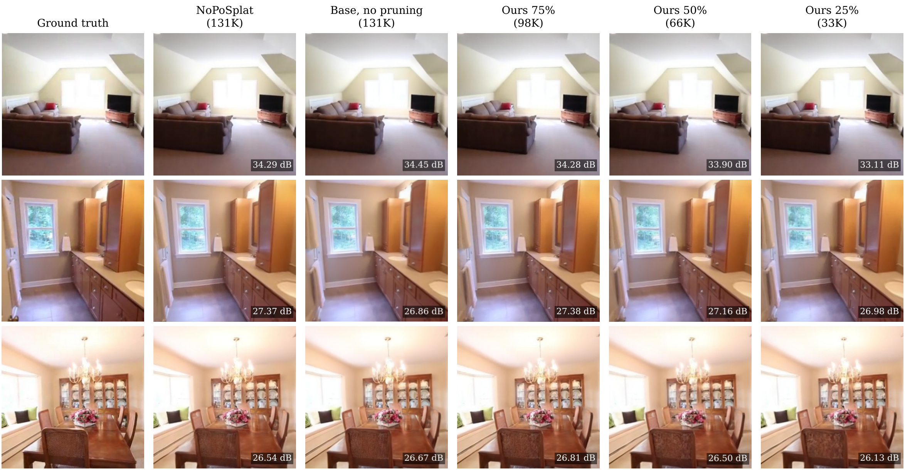
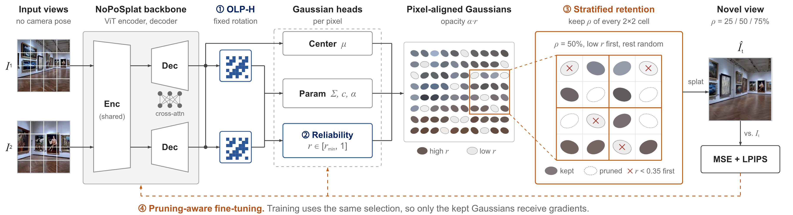
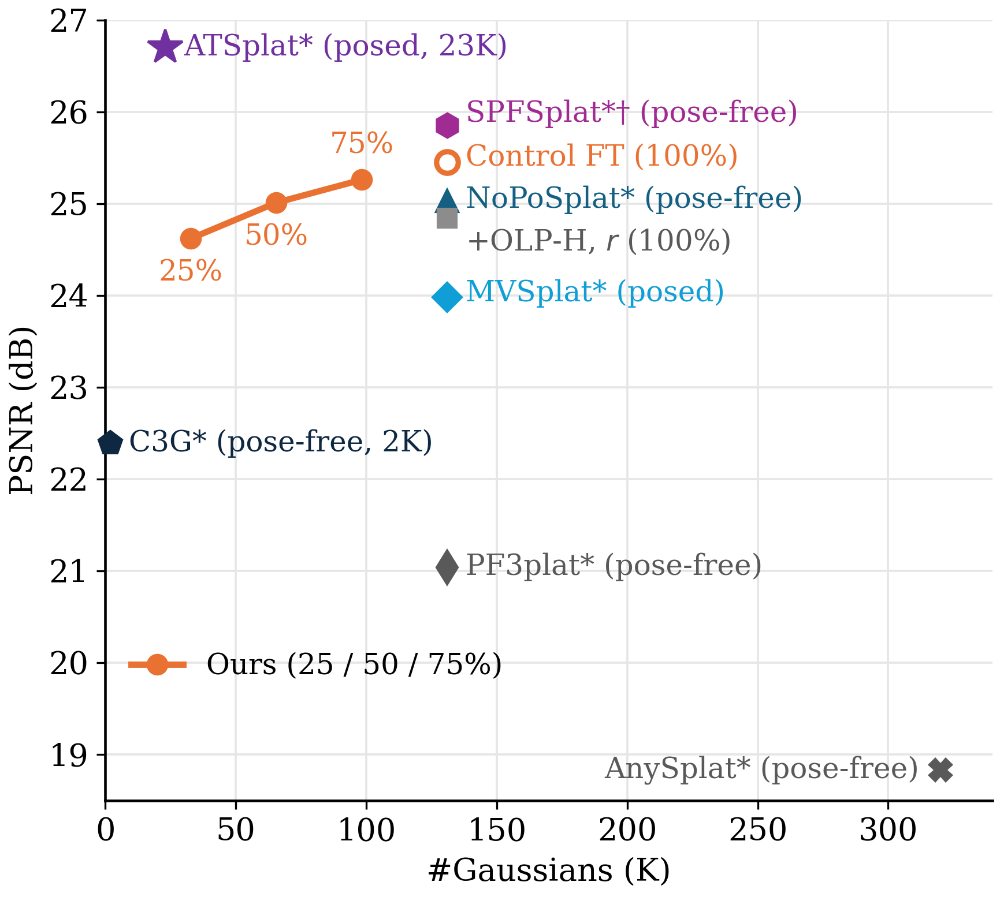
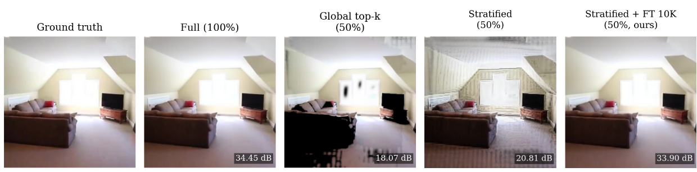

<div align="center">

<h1>EvenSplat: Compact Pose-Free<br>Feed-Forward 3D Gaussian Splatting</h1>

**Kyoosuk Hwang** · **Junyoung Kwon**

Seoul National University of Science and Technology · Capstone Design 2026

[](#requirements)
[](#requirements)
[](#requirements)
[](https://huggingface.co/kyoosuk/LitePoSplat)
[](LICENSE)

</div>

<p align="center">
  
</p>

**EvenSplat** renders novel views from **two unposed images** using **25 to 75% of the per-pixel Gaussians**
and stays close to the unpruned model. On the RealEstate10K test set, keeping 75% beats NoPoSplat in PSNR
(25.26 vs. 25.03 dB), and keeping 50% comes within 0.02 dB while halving peak render memory (167 → 87 MB).

## Method

<p align="center">
  
</p>

| | Component | Idea | Code |
| :-: | --- | --- | --- |
| ① | **OLP-H** | Fixed orthogonal Hadamard rotation of the Gaussian-head feature | [`olp.py`](src/model/encoder/heads/olp.py) |
| ② | **Reliability head** | Per-Gaussian gate *r* on opacity, trained with a context-residual loss | [`reliability.py`](src/model/encoder/heads/reliability.py), [`loss_reliability.py`](src/loss/loss_reliability.py) |
| ③ | **Stratified retention** | Keep the same fraction in every 2×2 pixel cell; drop *r* < 0.35 first, fill the rest at random | [`retention/`](src/model/retention/) |
| ④ | **Pruning-aware fine-tuning** | Train with the same selection so the kept Gaussians cover the gaps | [`model_wrapper.py`](src/model/model_wrapper.py) |

Retention runs before rasterization, so the renderer only sees the kept Gaussians. Every component is off by
default, and the default config reproduces NoPoSplat. Details: [docs/METHOD.md](docs/METHOD.md).

## Results

RealEstate10K, 256 × 256, two context views, full test set (5,590 evaluable scenes).

<p align="center">
  
</p>
<p align="center"><sub>Full RealEstate10K test set. *Reported in NoPoSplat. **Reported in ATSplat. Posed methods use ground-truth
camera poses. <i>Control</i> is our base fine-tuned for the same 10K steps without pruning.</sub></p>

| Model | #Gaussians | PSNR ↑ | SSIM ↑ | LPIPS ↓ |
| --- | :-: | :-: | :-: | :-: |
| pixelSplat* (posed) | 393K | 23.85 | 0.806 | 0.185 |
| MVSplat* (posed) | 131K | 23.98 | 0.811 | 0.176 |
| ATSplat** (posed, compact) | 23K | 26.70 | 0.861 | 0.146 |
| NoPoSplat* | 131K | 25.03 | 0.838 | 0.160 |
| Base (① + ②) | 131K | 24.84 | 0.824 | 0.163 |
| Control (base + 10K FT, no pruning) | 131K | 25.45 | 0.842 | 0.155 |
| **EvenSplat 75%** | **98K** | **25.26** | **0.837** | **0.161** |
| **EvenSplat 50%** | **66K** | **25.01** | **0.829** | **0.169** |
| **EvenSplat 25%** | **33K** | **24.62** | **0.817** | **0.184** |

**Ablation** at 50% kept (full test set). Global top-k removes whole regions; stratified cells keep every region,
and fine-tuning closes the remaining gaps.

<p align="center">
  
</p>

| Setting | PSNR ↑ | SSIM ↑ | LPIPS ↓ |
| --- | :-: | :-: | :-: |
| Global top-k by *r*, no fine-tuning | 14.39 | 0.529 | 0.390 |
| + stratified 2 × 2 cells | 19.16 | 0.625 | 0.354 |
| + pruning-aware fine-tuning (2K steps) | 24.78 | 0.824 | 0.175 |
| + *r* filter | 24.88 | 0.826 | 0.172 |
| + fine-tuning 10K steps (**final**) | **25.01** | **0.829** | **0.169** |
| Fine-tune 10K without pruning, then select | 19.13 | 0.635 | 0.348 |

## Requirements

- Linux, one NVIDIA GPU, CUDA 11.8
- Python 3.10, PyTorch 2.1.2

```bash
git clone https://github.com/junyoung6215/EvenSplat
cd EvenSplat
bash scripts/create_cuda118_env.sh     # conda env + Gaussian rasterizer
conda activate noposplat-olp-cuda118
```

Exact versions: [`env/environment-cuda118.yml`](env/environment-cuda118.yml).

### Directory structure

Data and checkpoints go under the repository root (both are git-ignored):

```text
EvenSplat/
├── src/
│   ├── model/
│   │   ├── encoder/heads/olp.py           # ① OLP-H
│   │   ├── encoder/heads/reliability.py   # ② reliability head
│   │   ├── retention/                     # ③ stratified retention, r filter
│   │   └── model_wrapper.py               # ④ retention in training and evaluation
│   ├── loss/loss_reliability.py           # ② context-residual loss
│   └── experiment_runner/retention.py     # train / eval-grid / summarize
├── config/                                # Hydra configs (all components off by default)
│   └── experiment_runs/retention_suite.yaml   # runner settings for the final method
├── scripts/                               # environment, data, run_retention.py
├── assets/                                # evaluation indices
├── docs/                                  # METHOD.md, REPRODUCE.md, figures
├── tests/
├── datasets/re10k/                        # setup_re10k_dataset.sh
│   ├── train/*.torch, index.json
│   └── test/*.torch, index.json
├── checkpoints/                           # downloaded from Hugging Face
│   └── retention_r{25,50,75}_re10k.ckpt
└── pretrained_weights/re10k.ckpt          # NoPoSplat, only to rebuild the base model
```

## Data

RealEstate10K in the chunked format of [DATASETS.md](DATASETS.md):

```bash
RE10K_SOURCE_DIR=/path/to/re10k bash scripts/setup_re10k_dataset.sh
```

| Index | Scenes | Use |
| --- | :-: | --- |
| [`evaluation_index_re10k.json`](assets/evaluation_index_re10k.json) | 5,601 | full test set (reported numbers) |
| [`evaluation_index_re10k_test500.json`](assets/evaluation_index_re10k_test500.json) | 500 | quick test |
| [`evaluation_index_re10k_val64.json`](assets/evaluation_index_re10k_val64.json) | 64 | validation during fine-tuning |

## Checkpoints

| Model | Gaussians kept | Download |
| --- | :-: | :-: |
| EvenSplat 25% | 33K | [`retention_r25_re10k.ckpt`](https://huggingface.co/kyoosuk/LitePoSplat/blob/main/retention_r25_re10k.ckpt) |
| EvenSplat 50% | 66K | [`retention_r50_re10k.ckpt`](https://huggingface.co/kyoosuk/LitePoSplat/blob/main/retention_r50_re10k.ckpt) |
| EvenSplat 75% | 98K | [`retention_r75_re10k.ckpt`](https://huggingface.co/kyoosuk/LitePoSplat/blob/main/retention_r75_re10k.ckpt) |
| Base (① + ②), fine-tuning start | 131K | [`epoch_1-step_75000.ckpt`](https://huggingface.co/kyoosuk/noposplat-olp-rel-re10k) |

```bash
hf download kyoosuk/LitePoSplat retention_r50_re10k.ckpt --local-dir checkpoints
```

## Evaluation

Copy [`config/experiment_runs/retention_suite.yaml`](config/experiment_runs/retention_suite.yaml) to
`my_settings.yaml` and set `data_root` and `output_root`. Each command prints its plan; `--execute` runs it.

```bash
# EvenSplat 50% on the full test set (use --split test for the 500-scene subset)
python scripts/run_retention.py --config my_settings.yaml eval-grid --split full \
  --checkpoint checkpoints/retention_r50_re10k.ckpt \
  --baselines none --scores r_filter --ratios 0.5 --run-id ours_r50 --execute
```

Metrics are written to `<output_root>/ours_r50/r_filter-r0.5-cell2/test_metrics.json`.
Add `evaluation.save_image: true` to the settings to save renders.

## Training

Set `initial_checkpoint` to the base checkpoint and fine-tune with retention (10K steps, one GPU):

```bash
python scripts/run_retention.py --config my_settings.yaml train --prune --ratio 0.5 --run-id ours_r50 --execute
```

Rebuilding the base model, the ablations and every option: [docs/REPRODUCE.md](docs/REPRODUCE.md).

## Tests

```bash
PYTHONPATH=tests python -m unittest discover -s tests
```

No GPU, data or checkpoint needed.

## Acknowledgements

Built on [NoPoSplat](https://github.com/cvg/NoPoSplat), which provides the backbone, data pipeline and pretrained
checkpoint, and in turn on [pixelSplat](https://github.com/dcharatan/pixelsplat),
[DUSt3R](https://github.com/naver/dust3r) and [CroCo](https://github.com/naver/croco).

## License

[MIT](LICENSE). The base code is © 2024 Botao Ye.
